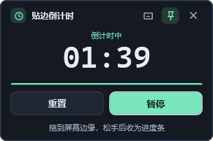

# EdgeCountdown · 贴边倒计时

一款轻量的 Windows 11 桌面倒计时工具。开始后自动缩成迷你条，拖到屏幕边缘可收成一条进度条。收起窗口后仍可在托盘后台计时，到点弹窗提醒。

## 软件截图

| 展开窗口 | 迷你模式 | 贴边进度条 |
| :---: | :---: | :---: |
|  |  |  |

## 下载与运行

1. 打开 [EdgeCountdown.exe](EdgeCountdown.exe) 的文件页面，点击右上角的下载图标（**Download raw file**）。[GitHub 下载单个文件说明](https://docs.github.com/en/repositories/working-with-files/using-files/viewing-and-understanding-files)
2. 在 Windows 11 上双击下载好的 EXE。单个文件即可运行，无需安装，可放到任意文件夹。

## 使用方法

1. **输入时长并点击「开始」**。整数表示分钟，带点的写法按「小时.分钟」读取。剩余时间以 `HH:MM` 显示，精确到分钟。

   | 输入 | 时长 | 显示 |
   | --- | --- | --- |
   | `15` | 15 分钟 | `00:15` |
   | `1.39` | 1 小时 39 分钟 | `01:39` |
   | `2.00` | 2 小时 | `02:00` |

2. **移动或贴边**。按住窗口标题栏或迷你条即可拖动，靠近屏幕边缘时松手会自动吸附。计时中的迷你条贴边后只显示进度，拖离屏幕边缘后恢复数字显示。
3. **暂停、继续或重置**。单击迷你条或贴边进度条展开窗口，再点击相应按钮。点标题栏上的迷你模式按钮可再次缩小。
4. **置顶或收进托盘**。点击图钉切换置顶，点击右上角 **×** 将窗口收进右下角托盘。软件只在托盘显示图标，计时继续运行，到时会弹窗。单击托盘图标可恢复窗口，右键选择「退出」可彻底关闭软件。找不到图标时，可先点托盘旁的 **^** 查看隐藏图标。

软件会记住上次的窗口位置（包括贴边位置）、置顶状态和输入的时长，下次打开时自动恢复这些设置。
